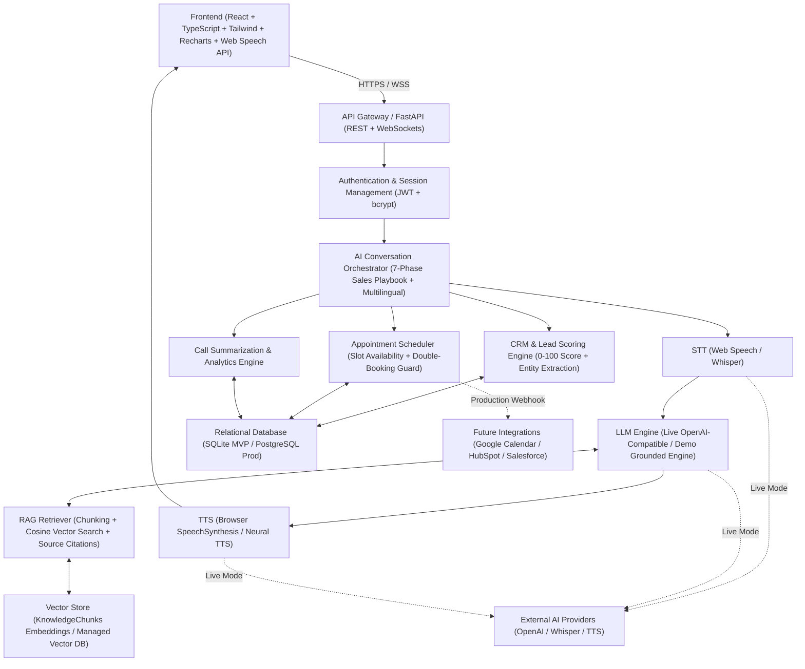

# System Architecture

## Overview

Fortivex AI is designed as a modular, API-first **Autonomous AI Sales Voice Agent** platform. It supports two explicitly separated runtime modes:

- **DEMO MODE (Default when no API key is provided)**: Uses browser Web Speech API (`SpeechRecognition` + `speechSynthesis`), deterministic local feature-hashing vector embeddings stored in SQLite, rule-enhanced sentiment & intent classification, and grounded template/RAG sales responses.
- **LIVE AI MODE (When `DEMO_MODE=false` and `OPENAI_API_KEY` is configured)**: Uses OpenAI-compatible Chat Completions, Whisper STT, Neural TTS, and dense API embeddings, with automatic graceful fallback to local engines on transient failures.

## End-to-End Architecture Diagram

## 7-Phase Sales Conversation State Machine

1. **INTRODUCTION**: Agent introduces itself and company in the selected language (`en` / `hi`).
2. **DISCOVERY**: Probes customer pain points and business goals.
3. **LEAD_QUALIFICATION**: Collects missing fields (name, email, phone, industry, budget, timeline, requirements) without repeating already-captured fields.
4. **PRODUCT_EXPLANATION**: Grounds answers strictly in retrieved Knowledge Base chunks with source citations.
5. **OBJECTION_HANDLING**: Addresses pricing, timing, competitor, or interest objections empathetically.
6. **APPOINTMENT_BOOKING**: Checks real-time slot availability, prevents double booking, and writes confirmed appointments to the database.
7. **CONCLUSION**: Closes politely and triggers automated post-call summarization.
